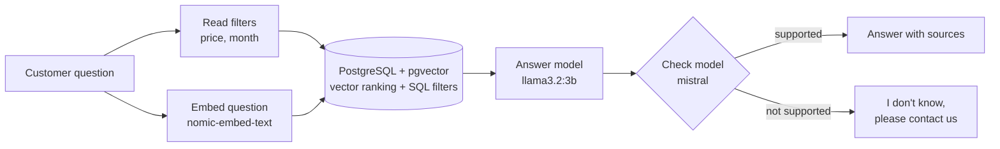

# AI Travel Assistant — RAG Chatbot, MCP Server & n8n Workflow


-000000)


An AI assistant for a travel agency that answers customer questions **only from live data** in PostgreSQL: offers, prices, dates, seats left and agency rules. Built three ways, one folder each:

| | Project | For a client who wants… |
|---|---|---|
| 1 | [**RAG Chatbot**](rag-chatbot/) | a chat on their website, written in Python |
| 2 | [**MCP Server**](mcp-server/) | Claude or ChatGPT to search their own database |
| 3 | [**n8n Workflow**](n8n-workflow/) | an AI workflow their team can edit without code |

All three use the same database and run on **local models with Ollama**, so customer data never leaves the server.

> The offers and rules in [`data/`](data/) are realistic demo data, not a real agency's prices.

---

## Why this is not a basic chatbot

Most RAG demos fail in the same ways: they invent prices, sell trips that are sold out, and cannot handle "under 1000 DT". This project fixes each one on purpose:

| Problem | How it is solved |
|---|---|
| Vector search is bad at numbers ("under 1000 DT", "in November") | **Hybrid search**: vectors rank by meaning, SQL filters by price, month, seats and status |
| Prices and seats change every day | Only descriptions are embedded. Price, dates and seats are **read live** from the database at question time, so a sold-out trip disappears instantly |
| LLMs invent answers | The model must cite its sources, and a **second model checks** the answer against those sources before the customer sees it |
| Off-topic questions | The assistant says *"I don't know, please contact us"* instead of guessing |

## Results

An automatic test suite ([`rag-chatbot/evaluate.py`](rag-chatbot/evaluate.py)) asks 12 questions and scores the answers: **11 / 12 correct**.

| Test | Example | Result |
|---|---|---|
| Search by meaning | "I want a relaxing spa weekend near the sea" → Hammamet Thalasso Weekend | ✅ |
| Price filter | "Trips under 1000 DT?" → only Djerba, Hammamet, Tabarka | ✅ |
| Month filter | "What can I do in November?" | ✅ |
| Sold-out / archived trips | "Can I go to the Tabarka jazz festival?" → "I don't know" | ✅ |
| Agency rules | Deposit, visas, children | ✅ ✅ ❌ |
| Out of scope | "Trips to Japan?", "Can I bring my cat?" → "I don't know" | ✅ ✅ |
| French | "Combien coûte le voyage à Marrakech ?" → 2600 DT | ✅ |

The one failure is a real data conflict (an offer's own child price vs. the general child discount). The checker **blocked** the wrong answer instead of letting it through.

## How it works



---

## Setup

**Requirements:** Python 3.12+, [Ollama](https://ollama.com), and a PostgreSQL database with pgvector (Neon, Supabase, or the `pgvector/pgvector` Docker image).

```bash
# 1. Local models
ollama pull nomic-embed-text
ollama pull llama3.2:3b
ollama pull mistral

# 2. Database: tables + demo data (shared by all three projects)
psql "$DATABASE_URL" -f data/schema.sql
psql "$DATABASE_URL" -f data/seed.sql

# 3. Build the vectors, then run the chatbot
cd rag-chatbot
pip install -r requirements.txt
cp .env.example .env      # put your DATABASE_URL here
python ingest.py
streamlit run app.py
```

Then see each folder's README: [RAG Chatbot](rag-chatbot/README.md) · [MCP Server](mcp-server/README.md) · [n8n Workflow](n8n-workflow/README.md).

## Project structure

```
ai-travel-assistant/
├── rag-chatbot/          # 1. Python RAG assistant + Streamlit chat + test suite
│   ├── assistant.py      #    filters, hybrid search, answer, answer check
│   ├── app.py            #    Streamlit chat page
│   ├── evaluate.py       #    12-question automatic test suite
│   ├── ingest.py         #    builds the vectors
│   └── db.py
├── mcp-server/           # 2. MCP server with 3 read-only tools
│   ├── mcp_server.py
│   ├── test_mcp.py       #    calls every tool over the MCP protocol
│   └── db.py
├── n8n-workflow/         # 3. n8n workflow + import guide
│   └── travel_assistant.json
└── data/                 # shared by all three
    ├── schema.sql        #    tables + pgvector
    ├── seed.sql          #    14 demo offers
    └── agency_faq.txt    #    12 agency rules
```

## Limitations

- Small local models are slow on a laptop (about 10–30 s per answer with the check). A hosted model would answer in 1–3 s.
- The checker reduces invented answers but does not remove all of them; a production version would add more tests and human review of blocked answers.
- Filters for price and month use rules (regex). An LLM-based filter extractor would handle more phrasings.

## Author

**Abdelhamid B.** — AI Agent & Automation Developer (n8n, RAG, MCP, Python)
[Hire me on Upwork](https://www.upwork.com/freelancers/~013a26f2e99bccc385)

## License

[MIT](LICENSE)
